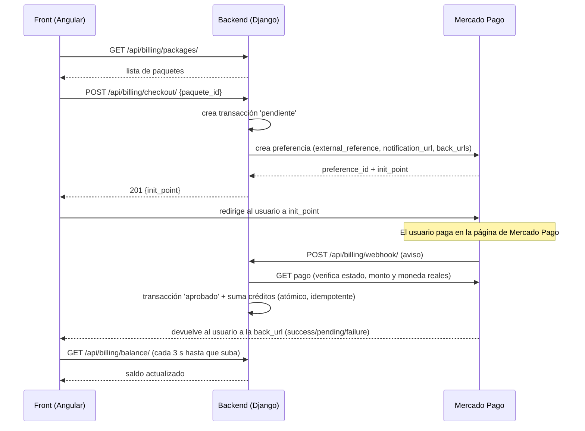
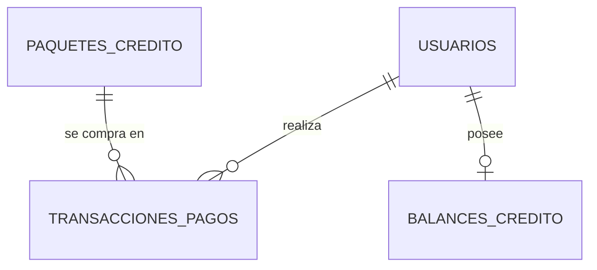

# Billing: créditos, paquetes y pagos con Mercado Pago

### Pinta Ebook — Documentación técnica (módulo `billing` — Estado Actual)

> **Estado: integración completa y probada de punta a punta** con cuentas de prueba de Mercado Pago.
> Un usuario elige un paquete → paga en Mercado Pago → el backend recibe el aviso, verifica el pago y le acredita los créditos.
>
> Esta guía reemplaza a `workflow_billing_webhook.md` (eliminado: su contenido está en la sección 7).

## Índice

1. [Qué hace esta feature (en 30 segundos)](#1-qué-hace-esta-feature-en-30-segundos)
2. [Conceptos básicos](#2-conceptos-básicos)
3. [Flujo completo](#3-flujo-completo)
4. [Endpoints (entrada y salida)](#4-endpoints-entrada-y-salida)
5. [Guía para el frontend (Angular), paso a paso](#5-guía-para-el-frontend-angular-paso-a-paso)
6. [Cómo pagar en modo prueba (qué hace el usuario)](#6-cómo-pagar-en-modo-prueba-qué-hace-el-usuario)
7. [Cómo funciona el webhook por dentro](#7-cómo-funciona-el-webhook-por-dentro)
8. [Configuración: variables de entorno](#8-configuración-variables-de-entorno)
9. [Datos: tablas, estados y reglas](#9-datos-tablas-estados-y-reglas)
10. [Cómo probar y verificar](#10-cómo-probar-y-verificar)
11. [Problemas frecuentes](#11-problemas-frecuentes)
12. [Despliegue en producción](#12-despliegue-en-producción)
13. [Archivos del módulo, decisiones y próximos pasos](#13-archivos-del-módulo-decisiones-y-próximos-pasos)

---

## 1. Qué hace esta feature (en 30 segundos)

Los e-books se generan con **créditos**. Cuando un usuario se queda sin créditos, puede **comprar paquetes** pagando con **Mercado Pago (Checkout Pro)**.

- La página de pago es **de Mercado Pago**: nuestra app nunca ve ni guarda datos de tarjetas.
- Los créditos **los acredita el backend**, nunca el frontend, cuando Mercado Pago le confirma el pago.
- Hoy el proyecto usa **cuentas de prueba** de Mercado Pago: los pagos son ficticios y no mueven dinero real (ver sección 6).

### Paquetes cargados por defecto (migración `0003_seed_credit_packages`)

| id | Nombre | Créditos | Precio (ARS) |
|---|---|---|---|
| 1 | Básico | 100 | 1.000 |
| 2 | Estándar | 500 | 4.000 |
| 3 | Pro | 1000 | 7.000 |

Se cargan solos con `python manage.py migrate`. No hay que crearlos a mano.

---

## 2. Conceptos básicos

| Término | Qué es |
|---|---|
| **Checkout Pro** | Modalidad de Mercado Pago (MP) en la que **MP aloja la página de pago**. Nuestra app solo redirige al usuario a una URL de MP. |
| **Access Token** | Credencial secreta del backend para hablar con la API de MP. Vive solo en el `.env`/variables del servidor. |
| **Preferencia** | "Pedido de cobro" que el backend crea en MP: qué se vende, cuánto cuesta, a dónde volver y a dónde avisar. |
| **`init_point`** | URL de pago de esa preferencia. El front redirige al usuario a ella. |
| **`external_reference`** | Texto que enviamos a MP y que MP nos devuelve en el pago. Acá es el **ID de nuestra `PaymentTransaction`**; así sabemos qué pago corresponde a qué compra. |
| **Webhook** | Endpoint **del backend** al que **MP llama** para avisar "hubo novedades en un pago". Es la única fuente confiable para acreditar. |
| **`notification_url`** | URL **pública** del webhook, enviada dentro de la preferencia. Sin ella, MP no sabe a dónde avisar. |
| **`back_urls`** | Páginas **del frontend** a las que MP devuelve al usuario al terminar (`success`, `failure`, `pending`). |
| **Cuentas de prueba** | Usuarios ficticios de MP (vendedor y comprador) para simular pagos sin dinero real. |
| **Túnel (ngrok)** | Da una URL pública que apunta a tu `localhost`. Solo hace falta en desarrollo, porque MP no puede llegar a `localhost`. |

**Por qué el webhook es imprescindible:** cuando el usuario vuelve del pago *no se puede confiar* en lo que dice la URL de retorno (`?status=approved` lo puede escribir cualquiera, y el usuario puede cerrar la pestaña antes de volver). Por eso MP avisa **de servidor a servidor** y el backend **verifica el pago directamente con MP** antes de acreditar.

---

## 3. Flujo completo



> **Importante:** el aviso del webhook y el regreso del usuario pueden ocurrir **en cualquier orden**. Por eso, al volver, el front **consulta el saldo repetidamente** y no afirma "acreditado" por sí solo.

---

## 4. Endpoints (entrada y salida)

Todos cuelgan de `/api/` (lo define `config/urls.py`). Salvo el webhook, **requieren JWT**: `Authorization: Bearer <access_token>`.

| Método | Ruta | Para qué | Auth | Lo usa |
|---|---|---|---|---|
| `GET` | `/api/billing/packages/` | Listar paquetes | JWT | Front |
| `POST` | `/api/billing/checkout/` | Iniciar el pago de un paquete | JWT | Front |
| `GET` | `/api/billing/balance/` | Consultar saldo | JWT | Front |
| `POST` | `/api/billing/webhook/` | Recibir avisos de Mercado Pago | **Ninguna** | **Solo Mercado Pago** |

### 4.1 `GET /api/billing/packages/`

Catálogo de paquetes, ordenado de menor a mayor precio. **Sin paginar** (son pocos).

- **Request:** sin body ni parámetros.
- **Respuesta `200 OK`:**

```json
[
  { "id": 1, "nombre": "Básico",   "cantidad_creditos": 100,  "precio": "1000.00" },
  { "id": 2, "nombre": "Estándar", "cantidad_creditos": 500,  "precio": "4000.00" },
  { "id": 3, "nombre": "Pro",      "cantidad_creditos": 1000, "precio": "7000.00" }
]
```

| Campo | Tipo | Descripción |
|---|---|---|
| `id` | entero | Es el `paquete_id` que se envía al checkout |
| `nombre` | string | Nombre para mostrar |
| `cantidad_creditos` | entero | Créditos que se acreditan al pagar |
| `precio` | **string** decimal | **Llega como texto** (`"1000.00"`), no como número. Convertir con `Number()` solo para mostrar. Moneda: ARS |

- **Errores:** `401` si falta el token o venció.

### 4.2 `POST /api/billing/checkout/`

Inicia el pago: crea la preferencia en MP, registra la transacción `pendiente` y devuelve la URL de pago.

- **Content-Type:** `application/json`
- **Request (body):**

```json
{ "paquete_id": 1 }
```

| Campo | Tipo | Obligatorio | Regla |
|---|---|---|---|
| `paquete_id` | entero | Sí | Entre 1 y 2147483647. Debe ser el `id` de un paquete existente |

> **No enviar** monto, usuario ni nada más. El precio sale **siempre** del paquete en la base de datos y el usuario sale del token.

- **Respuesta `201 Created`:**

```json
{
  "init_point": "https://www.mercadopago.com.ar/checkout/v1/redirect?pref_id=3758943952-7ab06e45-..."
}
```

El front debe **redirigir** a esa URL: `window.location.href = init_point` (es una navegación completa, no una llamada HTTP).

- **Errores:**

| Código | Cuándo | Cuerpo de ejemplo | Qué hacer en el front |
|---|---|---|---|
| `400` | Falta `paquete_id`, no es entero o es menor a 1 | `{"paquete_id": ["This field is required."]}` | Es un bug del front; mostrar error genérico |
| `400` | Paquete con precio 0 (no comprable) | `{"detail": "El paquete de créditos seleccionado no se puede comprar."}` | Mostrar el mensaje |
| `401` | Sin token o token vencido | `{"detail": "Authentication credentials were not provided."}` | Refrescar token o ir a login |
| `404` | El paquete no existe | `{"detail": "El paquete de créditos solicitado no existe."}` | Recargar el listado de paquetes |
| `502` | MP rechazó el pedido o respondió algo inválido | `{"detail": "La pasarela de pagos devolvió una respuesta inesperada. ..."}` | "No pudimos iniciar el pago, reintentá" |
| `503` | MP caído, tardó más de 10 s, o el servidor no tiene credenciales | `{"detail": "La pasarela de pagos no está disponible en este momento. ..."}` | Igual que 502; se puede reintentar |

**Reglas para el front:**
- **Decidir por el código HTTP, no por el texto del mensaje** (mezclan español e inglés y pueden cambiar).
- **Deshabilitar el botón "Comprar" mientras la petición está en curso.** Cada `201` crea una transacción `pendiente` nueva: un doble clic genera dos.

### 4.3 `GET /api/billing/balance/`

- **Request:** sin body ni parámetros (el usuario sale del token).
- **Respuesta `200 OK`:**

```json
{ "credits_available": 1100, "last_updated": "2026-10-12T06:10:20.123456Z" }
```

| Campo | Tipo | Descripción |
|---|---|---|
| `credits_available` | entero ≥ 0 | Créditos disponibles |
| `last_updated` | string ISO 8601 | Última modificación del saldo (UTC). Convertir a `Date` para formatear |

- Si el usuario no tiene saldo creado, lo crea en ese momento con 0 créditos (nunca devuelve 404).
- Los campos llegan en `snake_case`. Es solo lectura.
- Errores: `401` sin token válido.

### 4.4 `POST /api/billing/webhook/` (solo para Mercado Pago)

**El front NO usa este endpoint.** Se documenta para entender el sistema y para depurar.

- **Autenticación:** ninguna (lo llama MP). La seguridad no depende de quién llama, sino de que el backend **verifica el pago con MP** (sección 7).
- **Qué recibe.** MP envía el tipo y el id en cualquiera de estos formatos (todos soportados):

| Formato | Ejemplo |
|---|---|
| Query moderna | `?type=payment&data.id=123456` |
| Body JSON | `{"type": "payment", "data": {"id": "123456"}}` |
| IPN por query | `?topic=payment&id=123456` o `?topic=merchant_order&id=987` |
| IPN por body | `{"topic": "merchant_order", "resource": "https://api.mercadolibre.com/merchant_orders/987"}` |

- **Tipos que procesa:**

| Tipo | El `id` es… | Qué hace |
|---|---|---|
| `payment` | ID del pago | Verifica ese pago y lo acredita si corresponde |
| `merchant_order` | ID de la orden | Consulta la orden, obtiene sus pagos y verifica cada uno |
| cualquier otro | — | Se ignora (`200`) |

- **Respuestas:**

| Código | Cuándo | ¿MP reintenta? |
|---|---|---|
| `200 {"detail": "OK"}` | Procesado, ya procesado antes, o ignorado por su estado | No |
| `200 {"detail": "Notificación ignorada."}` | Tipo de aviso que no nos interesa | No |
| `400` | El id no es numérico | Sí |
| `404` | MP no conoce ese pago/orden (a veces tarda en estar disponible) | Sí |
| `502` / `503` | MP respondió mal o está caído al verificar | Sí (es lo que queremos) |

---

## 5. Guía para el frontend (Angular), paso a paso

El proyecto `pintaebook-front-tester` **ya tiene todo implementado y funcionando**: se puede copiar tal cual. Archivos de referencia:

| Archivo | Para qué |
|---|---|
| `src/app/core/services/billing.service.ts` | Servicio HTTP: `getBalance()`, `getPackages()`, `createCheckout()` |
| `src/app/features/billing/packages.component.ts` | Pantalla de paquetes y botón "Comprar" |
| `src/app/features/billing/payment-result.component.ts` | Pantalla de retorno con consulta del saldo |
| `src/app/app.routes.ts` | Rutas `/billing` y `/billing/result/:outcome` |

### Paso 1 — El servicio

```ts
export interface CreditPackage {
  id: number;
  nombre: string;
  cantidad_creditos: number;
  precio: string; // "1000.00": llega como string
}

@Injectable({ providedIn: 'root' })
export class BillingService {
  private readonly http = inject(HttpClient);
  private readonly BASE = 'http://localhost:8000/api/billing';

  getBalance()  { return this.http.get<Balance>(`${this.BASE}/balance/`); }
  getPackages() { return this.http.get<CreditPackage[]>(`${this.BASE}/packages/`); }
  createCheckout(paqueteId: number) {
    return this.http.post<{ init_point: string }>(`${this.BASE}/checkout/`, { paquete_id: paqueteId });
  }
}
```

El interceptor JWT existente (`jwt.interceptor.ts`) agrega el header `Authorization` solo.

### Paso 2 — Mostrar los paquetes

Llamar a `getPackages()` al cargar la pantalla y pintar una tarjeta por paquete con `nombre`, `cantidad_creditos` y `precio` (formateado con `Number(precio)`).

### Paso 3 — Botón "Comprar" → checkout → redirección

```ts
buy(pkg: CreditPackage) {
  if (this.buyingId() !== null) return;           // evita el doble clic
  this.buyingId.set(pkg.id);
  sessionStorage.setItem('balance_before_checkout', String(this.balance())); // para la pantalla de retorno

  this.billing.createCheckout(pkg.id).subscribe({
    next: ({ init_point }) => { window.location.href = init_point; },   // sale a Mercado Pago
    error: (err) => { this.buyingId.set(null); /* mostrar error según err.status */ },
  });
}
```

### Paso 4 — Pantallas de retorno

MP devuelve al usuario a una de **tres URLs** (las define el backend en `MERCADOPAGO_BACK_URL_*`, sección 8). El front debe tener una ruta para cada una (en el tester, una sola ruta con parámetro):

| URL de retorno | Significado | Qué mostrar |
|---|---|---|
| `/billing/result/success` | El pago se aprobó en MP | "Confirmando tu pago..." y consultar el saldo (paso 5) |
| `/billing/result/pending` | Pago pendiente (por ejemplo, efectivo) | "Se acreditará cuando se confirme" |
| `/billing/result/failure` | Pago rechazado o cancelado | "No se completó. Podés reintentar" |

### Paso 5 — Confirmar con el saldo (polling)

En `success`, **no afirmar que se acreditó**: el webhook puede no haber llegado todavía.

1. Antes de pagar se guardó el saldo previo (paso 3).
2. En la pantalla de retorno, consultar `GET /api/billing/balance/` **cada 3 segundos, máximo ~30 s**.
3. Si `credits_available` **superó** el saldo previo → "¡Créditos acreditados!".
4. Si se agota el tiempo → "Tu pago se está procesando, el saldo se actualizará en unos minutos". **No es un error**: MP reintenta el aviso.

### Qué NO hacer

- ❌ **Llamar al webhook.** Lo llama MP.
- ❌ **Confiar en los parámetros de la URL de retorno** (`status=approved`, `payment_id`...): cualquiera los puede escribir a mano.
- ❌ **Sumar créditos en el cliente** al volver del pago.
- ❌ **Enviar el precio** al checkout.
- ❌ **Permitir doble clic** en "Comprar".

### Orden recomendado del flujo de usuario (para probar)

1. Iniciar sesión en la app.
2. Ir a **Comprar créditos** (`/billing`).
3. Elegir un paquete y pulsar **Comprar**.
4. En Mercado Pago, iniciar sesión con el **usuario comprador de prueba** y pagar con tarjeta de prueba (sección 6).
5. Volver a la app (`/billing/result/success`) y ver el saldo actualizado.

---

## 6. Cómo pagar en modo prueba (qué hace el usuario)

El proyecto usa **cuentas de prueba** de Mercado Pago. Ninguna operación mueve dinero real.

### Cuentas involucradas

| Cuenta | Para qué | Dónde se usa |
|---|---|---|
| **Cuenta personal de MP** (la del desarrollador) | Entrar a Mercado Pago Developers y administrar la aplicación y las cuentas de prueba | Solo administración |
| **Vendedor de prueba** | Representa a PintaEbook. De acá sale el **Access Token** del backend | Variable `MERCADOPAGO_ACCESS_TOKEN` |
| **Comprador de prueba** | Representa al usuario que paga | Se usa en la página de pago de MP |

> El usuario/contraseña del comprador de prueba los muestra el panel de MP, en la sección **Cuentas de prueba** de la aplicación. Se pueden crear hasta 15 y no se pueden borrar.

### Pasos al pagar

1. Pulsar **Comprar** en la app: se abre la página de pago de Mercado Pago.
2. **Iniciar sesión con el usuario comprador de prueba** (nunca con la cuenta real ni con la del vendedor: una cuenta no puede pagarse a sí misma).
3. Elegir **tarjeta de crédito** y completar con una tarjeta de prueba (tabla de abajo).
4. Completar **todos** los campos, incluyendo **cuotas**.
5. Pulsar **Pagar**.
6. Volver a la app (botón "Volver al sitio" o redirección automática, según el entorno) y verificar el saldo.

### Tarjetas de prueba (Argentina)

| Dato | Valor |
|---|---|
| Mastercard | `5031 7557 3453 0604` |
| Visa | `4509 9535 6623 3704` |
| Vencimiento | `11/30` |
| CVV | `123` |
| **Titular `APRO`** | El pago se **aprueba** |
| Titular `OTHE` | Rechazado por error general |
| Titular `CONT` | Queda **pendiente** |
| Tipo y número de documento | DNI `12345678` |

> Verificar los datos vigentes en la [documentación oficial de tarjetas de prueba](https://www.mercadopago.com.ar/developers/es/docs/checkout-pro/test-cards): Mercado Pago puede cambiarlos.

### Si el botón "Pagar" queda gris

Es el problema más frecuente y **no es del backend**. Probar, en orden:

1. Abrir el link en una **ventana de incógnito** (las extensiones que bloquean scripts —uBlock, AdBlock, Brave Shields— deshabilitan el botón).
2. Cerrar sesión de MP e iniciar con el **comprador de prueba**.
3. Revisar que todos los campos estén completos, **incluidas las cuotas**.

---

## 7. Cómo funciona el webhook por dentro

### Los pasos

1. **Llega el aviso.** Se extrae solo el tipo y el ID (validado como numérico: termina en una URL hacia MP). El resto del contenido **no se usa**.
2. Si es `merchant_order`, se consulta la orden y se obtienen los IDs de sus pagos. Cada pago sigue el mismo camino.
3. **Se consulta a MP** el pago real (`GET /v1/payments/{id}`): estado, monto, moneda y `external_reference`.
4. **Se busca la transacción** con el `external_reference` (ID de nuestra `PaymentTransaction`).
5. **Dentro de una transacción de base de datos** se bloquea esa fila (`select_for_update`) y se decide:

| Situación | Resultado |
|---|---|
| Ya estaba `aprobado` | No se hace nada (idempotencia) |
| MP dice `approved` y monto y moneda coinciden | Transacción `aprobado` + se suman los créditos |
| MP dice `approved` pero monto o moneda no coinciden | **No se acredita**; error en logs; requiere revisión manual |
| MP dice `rejected` / `cancelled` y estaba `pendiente` | Pasa a `fallido` / `cancelado` |
| `pending`, `in_process`, otros | Sin cambios |
| `external_reference` no numérico o transacción inexistente | Se ignora y queda un warning en logs |

La consulta a MP se hace **fuera** de la transacción de base de datos, para no mantener filas bloqueadas mientras se espera la red.

### Por qué se procesa también `merchant_order`

En las pruebas reales, Mercado Pago avisó **solo de la orden** (`merchant_order`) y no del pago (`payment`). Si el webhook solo atendiera `payment`, el pago quedaría aprobado en MP pero **sin acreditar** en nuestro sistema. Por eso ambos tipos llevan al mismo procesamiento verificado.

### Idempotencia y concurrencia

MP puede enviar el mismo aviso varias veces, a veces casi a la vez (y puede avisar tanto de la orden como del pago). El bloqueo de fila dentro de una transacción atómica garantiza que se acredite **una sola vez**: el segundo aviso espera y, al entrar, encuentra la transacción ya `aprobado`.

### Seguridad

- El endpoint es público, así que **nunca se confía en el contenido recibido**: solo se toma un ID numérico y el estado real se obtiene de MP con nuestro token.
- El monto lo decide el backend (tomado del paquete) y se compara con lo que MP dice que cobró.
- Mejora futura: validar la cabecera `x-signature` de MP (firma HMAC) para descartar llamadas que no vienen de MP antes de consultar su API.

---

## 8. Configuración: variables de entorno

Se definen en `Pintaebook_backend/.env` (modelo en `.env.example`). **El `.env` está en `.gitignore`: nunca subir tokens al repositorio.**

| Variable | Obligatoria | Para qué sirve | Ejemplo en desarrollo |
|---|---|---|---|
| `MERCADOPAGO_ACCESS_TOKEN` | **Sí** | Credencial de la API (Access Token del **vendedor de prueba**, empieza con `APP_USR-`) | `APP_USR-...` |
| `MERCADOPAGO_NOTIFICATION_URL` | **Sí** | URL **pública** del webhook. Sin ella no se acreditan créditos | `https://xxxx.ngrok-free.dev/api/billing/webhook/` |
| `MERCADOPAGO_BACK_URL_SUCCESS` | Recomendada | Pantalla del front a la que vuelve el usuario si el pago se aprobó | `http://localhost:4200/billing/result/success` |
| `MERCADOPAGO_BACK_URL_FAILURE` | Recomendada | Ídem si el pago falló | `http://localhost:4200/billing/result/failure` |
| `MERCADOPAGO_BACK_URL_PENDING` | Recomendada | Ídem si el pago quedó pendiente | `http://localhost:4200/billing/result/pending` |
| `MERCADOPAGO_SANDBOX` | No | `True` usa el `sandbox_init_point`. **Con credenciales de cuenta de prueba dejar en `False`** (ver nota) | `False` |
| `MERCADOPAGO_MOCK_MODE` | No | `True` simula el checkout sin llamar a MP (solo desarrollo y tests). **En producción, `False`** | `False` |
| `MERCADOPAGO_BASE_URL` | No | URL base de la API de MP | `https://api.mercadopago.com` (por defecto) |
| `ALLOWED_HOSTS` | **Sí** | Dominios que Django acepta, separados por coma. **Debe incluir el dominio del túnel/producción** o el webhook da `400` | `localhost,127.0.0.1,xxxx.ngrok-free.dev` |
| `CORS_ALLOWED_ORIGINS` | En producción | Orígenes del front permitidos (por defecto `localhost:4200` y `127.0.0.1:4200`) | `https://mi-front.com` |

### Notas importantes

- **`MERCADOPAGO_SANDBOX`:** según la documentación de MP, las credenciales de una cuenta de prueba ya funcionan como credenciales de prueba con el `init_point` normal. El `sandbox_init_point` fue la causa probable de que el botón "Pagar" no se habilitara en las primeras pruebas.
- **`auto_return`:** el backend solo lo envía si la `back_url` de éxito es **`https://`**. Con `http://localhost`, MP rechaza la preferencia (`auto_return invalid`). En desarrollo el usuario vuelve con el botón "Volver al sitio" de MP; en producción, con `https`, vuelve solo.
- **`back_urls` con `localhost`:** MP puede ignorarlas (en las pruebas quedaron vacías en la preferencia). No afecta el cobro ni el webhook; solo la vuelta automática. Para probar la pantalla de retorno en local, abrir a mano `http://localhost:4200/billing/result/success`.
- **Usar el mismo origen en el front y en las `back_urls`** (`localhost` o `127.0.0.1`, no mezclar): el token JWT está en `localStorage`, que es **por origen**; si MP devolviera a otro origen, el usuario aparecería deslogueado.
- **Cambios en el `.env`:** Django lee el `.env` al arrancar. Después de editarlo: `docker compose restart web`.
- **Cambios en el código Python:** Daphne **no recarga solo**. Si una ruta nueva da 404 o un cambio no se refleja: `docker compose restart web`.
- **La URL de ngrok gratuita cambia** cada vez que se reinicia ngrok: hay que actualizar `MERCADOPAGO_NOTIFICATION_URL` y `ALLOWED_HOSTS` y reiniciar `web`.

### Desarrollo local: puesta en marcha del túnel

1. Instalar ngrok (`winget install ngrok.ngrok`) y registrar el authtoken (`ngrok config add-authtoken <TOKEN>`; el authtoken es secreto).
2. Abrir el túnel en una terminal aparte y dejarla abierta: `ngrok http 8000`.
3. Copiar la URL `https://....ngrok-free.dev` que muestra y completar `MERCADOPAGO_NOTIFICATION_URL` (con `/api/billing/webhook/` al final) y `ALLOWED_HOSTS`.
4. `docker compose restart web`.
5. Verificar: abrir `https://TU-URL.ngrok-free.dev/api/billing/balance/` → debe responder `401 Authentication credentials were not provided` (significa que llegó a Django).
6. El inspector `http://127.0.0.1:4040` muestra cada llamada que MP hace al webhook.

---

## 9. Datos: tablas, estados y reglas

### Tablas

| Entidad Django | Tabla | Para qué sirve |
|---|---|---|
| `CreditBalance` | `balances_credito` | Saldo de créditos del usuario (uno por usuario) |
| `CreditPackage` | `paquetes_credito` | Catálogo de paquetes que se pueden comprar |
| `PaymentTransaction` | `transacciones_pagos` | Un registro por cada intento de pago |



#### `paquetes_credito`

| Columna | Tipo | Restricciones |
|---|---|---|
| `id` | integer (32 bits) | PK |
| `nombre` | varchar(100) | NOT NULL, UNIQUE |
| `cantidad_creditos` | integer | NOT NULL, CHECK `> 0` |
| `precio` | numeric(10,2) | NOT NULL, CHECK `>= 0` |

#### `transacciones_pagos`

| Columna | Tipo | Restricciones |
|---|---|---|
| `id` | integer (32 bits) | PK. Es el `external_reference` que se envía a MP |
| `usuario_id` | uuid | NOT NULL, FK a usuarios (CASCADE) |
| `paquete_id` | integer | NOT NULL, FK a paquetes (PROTECT) |
| `id_transaccion_externa` | varchar(255) | NOT NULL, UNIQUE. Guarda el ID de la **preferencia** de MP |
| `monto` | numeric(10,2) | NOT NULL, CHECK `> 0`. Lo cobrado (snapshot del precio) |
| `estado_transaccion` | varchar(50) | NOT NULL, CHECK IN (ver abajo) |
| `fecha` | timestamptz | NOT NULL, la completa PostgreSQL |

#### `balances_credito`

| Columna | Tipo | Detalle |
|---|---|---|
| `id` | uuid | PK |
| `usuario_id` | uuid | Relación uno a uno con el usuario |
| `credits_available` | entero ≥ 0 | Créditos disponibles. Al crearse un usuario, una signal (`signals.py`) le da `INITIAL_WELCOME_CREDITS` (hoy **1000**) |
| `last_updated` | timestamptz | Se actualiza en cada modificación |

### Estados de una transacción

| Estado | Significado |
|---|---|
| `pendiente` | Se inició el checkout; esperando el resultado del pago |
| `aprobado` | Pago confirmado y créditos acreditados. Estado final |
| `fallido` | El pago fue rechazado, o MP falló al crear la preferencia |
| `cancelado` | El pago fue cancelado |
| `reembolsado` | Reservado; hoy los reembolsos no se procesan |

Un pago rechazado **no** bloquea un intento posterior: el usuario puede reintentar sobre la misma preferencia y, si se aprueba, se acredita.

### Reglas de integridad (definidas en la base de datos)

| Regla | Constraint |
|---|---|
| Paquete con créditos > 0 | `paquete_cantidad_creditos_positiva` |
| Precio de paquete no negativo | `paquete_precio_no_negativo` |
| Monto de transacción > 0 | `transaccion_monto_positivo` |
| Estado válido (uno de los 5) | `transaccion_estado_valido` |
| Nombre de paquete único | `UNIQUE (nombre)` |
| Pago externo no repetido | `UNIQUE (id_transaccion_externa)` |

| Acción | Resultado |
|---|---|
| Borrar un **usuario** | Se borran sus transacciones (`CASCADE`) |
| Borrar un **paquete** con transacciones | No se permite (`PROTECT`) |

---

## 10. Cómo probar y verificar

### Tests automáticos

```bash
docker compose exec web python manage.py test apps.billing
```

Resultado esperado: **47 tests OK**. Cubren el catálogo, el checkout, el cliente de MP (timeouts, 4xx/5xx, respuestas malformadas, `notification_url`, `auto_return`) y el webhook (acreditación, idempotencia, monto distinto, rechazados, `merchant_order`, formatos IPN, ids inválidos). Reemplazan a MP por un doble: no necesitan red ni credenciales.

### Prueba rápida con curl (backend solo)

```bash
# 1) Login: devuelve "access" (JWT)
curl -X POST http://localhost:8000/api/auth/login/ -H "Content-Type: application/json" \
     -d '{"email":"usuario@correo.com","password":"su-clave"}'

# 2) Paquetes
curl http://localhost:8000/api/billing/packages/ -H "Authorization: Bearer <ACCESS>"

# 3) Checkout: devuelve init_point (abrirlo en el navegador, en incógnito)
curl -X POST http://localhost:8000/api/billing/checkout/ \
     -H "Authorization: Bearer <ACCESS>" -H "Content-Type: application/json" \
     -d '{"paquete_id": 1}'

# 4) Saldo (después de pagar y esperar unos segundos)
curl http://localhost:8000/api/billing/balance/ -H "Authorization: Bearer <ACCESS>"
```

### Prueba de punta a punta (con el front)

Requisitos: backend y front levantados, **ngrok abierto**, `.env` completo (sección 8).

1. Abrir `http://localhost:4200`, iniciar sesión.
2. Pulsar **+ Comprar créditos** → elegir un paquete → **Comprar**.
3. En Mercado Pago, iniciar sesión con el **comprador de prueba** y pagar (sección 6).
4. En `http://127.0.0.1:4040` (inspector de ngrok) debe aparecer un `POST /api/billing/webhook/` con `200`.
5. Volver a la app y verificar que el saldo subió.
6. Verificar en base de datos que la transacción quedó `aprobado`:

```bash
docker compose exec web python manage.py shell -c "from apps.billing.models import PaymentTransaction as P; [print(t.id, t.estado_transaccion, t.monto) for t in P.objects.order_by('-id')[:5]]"
```

### Probar el checkout sin Mercado Pago (modo mock)

Con `MERCADOPAGO_MOCK_MODE=True` el checkout devuelve un `init_point` de ejemplo (`example.com`) y la transacción queda `pendiente` con un `id_transaccion_externa` que empieza con `MOCK-`. Sirve para probar el front sin credenciales; **no hay pago real** y el webhook no aplica.

---

## 11. Problemas frecuentes

| Síntoma | Causa | Solución |
|---|---|---|
| Checkout devuelve `503` | `MERCADOPAGO_ACCESS_TOKEN` vacío o MP caído | Cargar el token en `.env` y `docker compose restart web`; ver `docker compose logs web` |
| Checkout devuelve `502` con `auto_return invalid` en logs | `back_url` de éxito con `http://localhost` | Ya resuelto: el backend solo manda `auto_return` con `https://`. Actualizar el backend |
| `GET /billing/packages/` da `404` | Daphne no recargó el código nuevo | `docker compose restart web` |
| El webhook no recibe nada | Falta `MERCADOPAGO_NOTIFICATION_URL`, ngrok cerrado o URL de ngrok distinta | Revisar `.env`, que ngrok esté abierto y el inspector (`127.0.0.1:4040`) |
| El webhook responde `400 DisallowedHost` | El dominio del túnel no está en `ALLOWED_HOSTS` | Agregarlo y reiniciar `web` |
| "Pagar" queda gris en MP | Extensión que bloquea scripts, sesión equivocada o formulario incompleto | Ver sección 6 |
| Pagué pero no se acreditaron créditos | Webhook no llegó o falló | Ver logs (`docker compose logs web`) y el inspector de ngrok; reenviar el aviso desde el inspector (botón *Replay*) |
| La transacción queda `pendiente` | El aviso no llegó todavía, o el pago está pendiente en MP | Esperar y revisar el webhook; si hace falta, reenviarlo |
| El usuario vuelve a la app deslogueado | Origen distinto (`127.0.0.1` vs `localhost`) | Usar el mismo origen en el front y en las `back_urls` |

---

## 12. Despliegue en producción

El hosting (Render, Railway, etc.) **no cambia nada del lado de Mercado Pago**: lo que decide si el pago es de prueba o real es el **Access Token**. Para este proyecto académico se pueden **mantener las cuentas de prueba** incluso desplegado (el comprador de prueba y las tarjetas de prueba siguen funcionando).

Lo que cambia al desplegar:

| Qué | Desarrollo | Producción |
|---|---|---|
| `MERCADOPAGO_NOTIFICATION_URL` | URL de ngrok | `https://<backend-desplegado>/api/billing/webhook/` (ya no hace falta ngrok) |
| `ALLOWED_HOSTS` | `localhost,...,<ngrok>` | Dominio del backend desplegado |
| `CORS_ALLOWED_ORIGINS` | `localhost:4200` | URL pública del front |
| `MERCADOPAGO_BACK_URL_*` | `http://localhost:4200/...` | `https://<front-desplegado>/billing/result/...` (con `https` el usuario vuelve solo) |
| `MERCADOPAGO_MOCK_MODE` | `False` | `False` |
| Dónde se guardan las variables | `.env` local | **Panel de variables del hosting** (no en el repositorio) |
| URL base de la API en el front | `http://localhost:8000/api/...` | URL del backend desplegado |

Para cobrar dinero real habría que usar credenciales de una cuenta real verificada de MP (solo cambia el token). No es necesario para este proyecto.

---

## 13. Archivos del módulo, decisiones y próximos pasos

### Archivos

| Archivo | Qué hace |
|---|---|
| `apps/billing/models.py` | `CreditBalance`, `CreditPackage`, `PaymentTransaction`, `EstadoTransaccion` |
| `apps/billing/migrations/0003_seed_credit_packages.py` | Carga los 3 paquetes iniciales (idempotente) |
| `apps/billing/services.py` | `BillingService`: checkout, procesamiento de pagos y de órdenes, créditos |
| `apps/billing/views.py` | Vistas: paquetes, saldo, checkout, webhook |
| `apps/billing/serializers.py` | Validación del body del checkout y formato de paquetes/saldo |
| `apps/billing/urls.py` | Rutas `billing/packages/`, `balance/`, `checkout/`, `webhook/` |
| `apps/billing/signals.py` | Crea el saldo inicial al registrarse un usuario |
| `infrastructure/mercadopago_client.py` | **Único** archivo que conoce Mercado Pago: crea preferencias, consulta pagos y órdenes, traduce errores |
| `apps/billing/tests.py`, `test_checkout.py`, `test_packages.py` | Tests automáticos |

### Decisiones de diseño

- **Tres capas (vista → servicio → adaptador):** cambiar de pasarela toca un solo archivo.
- **El monto sale siempre del paquete en la base**, nunca del request.
- **Se crea primero la transacción `pendiente`** y su ID viaja como `external_reference`. Si MP falla al crear la preferencia, la transacción queda `fallido`.
- **La llamada de red va fuera de la transacción de base de datos**, para no mantener filas bloqueadas mientras se espera a MP.
- **`requests` en lugar del SDK de MP:** se usan pocos endpoints; así el timeout (10 s) y el mapeo de errores quedan bajo nuestro control.
- **Errores tipados:** timeout, red, 5xx y 429 → `503` (reintentable); otros 4xx o respuesta inválida → `502`.
- **`CheckConstraint` además de `choices`:** las reglas se garantizan en la base, no solo en Python.

### Límites actuales y próximos pasos

- Validar la firma `x-signature` del webhook.
- Procesar reembolsos (hoy se ignoran).
- Guardar el Payment ID en una columna propia para trazabilidad (hoy `id_transaccion_externa` conserva el ID de preferencia).
- Endpoint para consultar el estado de una transacción puntual desde el front.
- Proceso de conciliación que revise transacciones `pendiente` por si un aviso se pierde.
- Un doble clic en "Comprar" crea dos transacciones `pendiente` (el front lo evita deshabilitando el botón).
