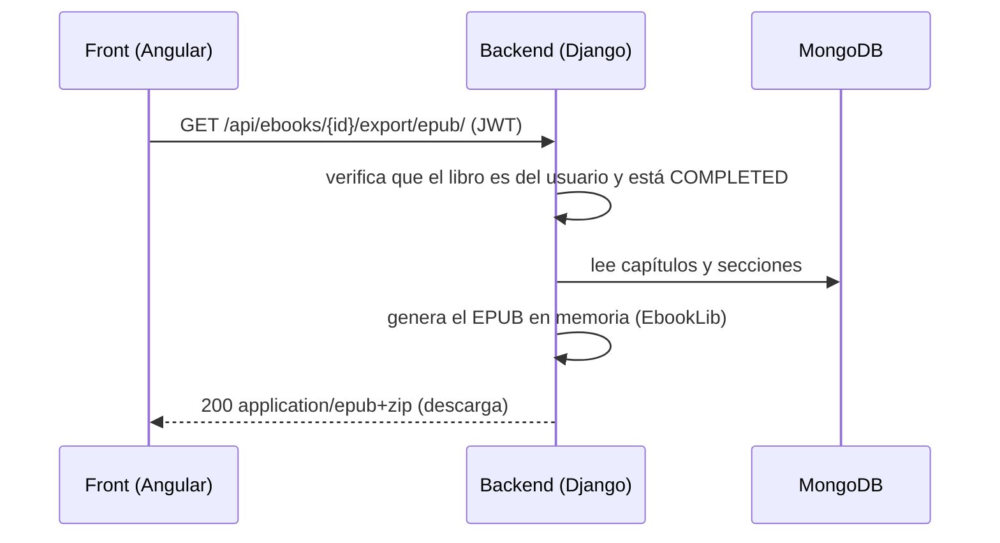

# Exportar un e-book como EPUB

### Pinta Ebook — Documentación técnica (módulo `exporter` — Estado Actual)

> **Estado:** implementado y probado (16 tests automáticos del módulo; 103 en toda la suite).
> Permite descargar cualquier e-book **terminado** (`COMPLETED`) como archivo `.epub`. Es **gratis**.

## Índice

1. [Qué hace](#1-qué-hace)
2. [Endpoint (entrada y salida)](#2-endpoint-entrada-y-salida)
3. [Cómo se genera el EPUB](#3-cómo-se-genera-el-epub)
4. [Guía para el frontend (Angular)](#4-guía-para-el-frontend-angular)
5. [Cómo probarlo](#5-cómo-probarlo)
6. [Limitaciones y próximos pasos](#6-limitaciones-y-próximos-pasos)
7. [Archivos del módulo](#7-archivos-del-módulo)

---

## 1. Qué hace

Toma el e-book del usuario (metadatos en PostgreSQL + capítulos y secciones en HTML en MongoDB) y lo empaqueta en un archivo **EPUB 3** que se puede abrir en cualquier lector (Calibre, Thorium, Apple Books, Kindle con conversión, etc.).



---

## 2. Endpoint (entrada y salida)

### `GET /api/ebooks/<ebook_id>/export/epub/`

| Campo | Detalle |
|---|---|
| Autenticación | Obligatoria: `Authorization: Bearer <access_token>` |
| Parámetros | `ebook_id` (UUID) en la ruta. Sin body ni query |
| Costo | **Gratis** (no descuenta créditos) |
| Quién puede | Solo el **autor** del e-book |
| Cuándo | Solo si el e-book está `COMPLETED` |

**Respuesta `200 OK`**

| Header | Valor |
|---|---|
| `Content-Type` | `application/epub+zip` |
| `Content-Disposition` | `attachment; filename="<titulo-en-slug>.epub"` |

El cuerpo es el archivo binario. Ejemplo de nombre: título `Mi Libro de Prueba` → `mi-libro-de-prueba.epub`.

**Errores** (siempre JSON `{"detail": "..."}`)

| Código | Cuándo | Mensaje | Qué hacer en el front |
|---|---|---|---|
| `401` | Sin token o token vencido | `Authentication credentials were not provided.` | Ir a login |
| `404` | El libro no existe **o es de otro usuario** (no se revela cuál) | `No EbookMetadata matches the given query.` | "No se encontró el e-book" |
| `404` | El libro no tiene contenido inicializado en MongoDB | `El libro no tiene contenido inicializado.` | Ídem |
| `409` | El e-book está `PROCESSING` o `FAILED` | `El e-book todavía no está terminado: solo se pueden exportar e-books completados.` | "Esperá a que termine la generación" |
| `409` | El e-book no tiene capítulos | `El e-book no tiene capítulos para exportar.` | "No hay contenido para exportar" |
| `503` | MongoDB no disponible | `No se pudo acceder al contenido del libro...` | Reintentar más tarde |

> **Decidir por el código HTTP, no por el texto.** Además, con `responseType: 'blob'` el cuerpo del error llega como `Blob`, no como objeto.

> **Qué se exporta:** lo que está **guardado** en el backend. Los cambios del editor que no se hayan guardado (botón *Guardar*) no entran en el archivo.

---

## 3. Cómo se genera el EPUB

| Elemento del e-book | Elemento del EPUB |
|---|---|
| `title` | Título del libro |
| Nombre y apellido del autor (o su email si no tiene) | Autor |
| `description` | Descripción (metadato) |
| `id` (UUID) | Identificador `urn:uuid:<id>` |
| — | Idioma `es` |
| Cada **capítulo** | Un archivo `chapter_N.xhtml` con su título como `<h1>` |
| Cada **sección** | Un `<h2>` con su título y su HTML debajo |
| Capítulos y secciones | Tabla de contenidos (`nav.xhtml` y `toc.ncx`), con las secciones anidadas |

### Tratamiento del HTML

El EPUB exige **XHTML bien formado**, y el HTML del editor es HTML5. Por eso cada sección pasa por:

1. **Sanitizado** (`nh3`, el mismo del módulo de contenido): quita `<script>`, eventos y todo lo inseguro.
2. **Limpieza de caracteres de control** que XML 1.0 no admite.
3. **Parseo y reserialización** con `lxml`: `<br>` → `<br/>`, etiquetas sin cerrar se cierran, `&` se escapa.
4. Se envuelve en `<div class="section">`.

Si un HTML es tan irregular que no se puede parsear, la sección se exporta como texto plano en lugar de fallar toda la exportación.

### Estilo
Se incluye una hoja de estilos mínima (`style/book.css`): tipografía serif, interlineado, justificado, imágenes al ancho de página.

---

## 4. Guía para el frontend (Angular)

El proyecto `pintaebook-front-tester` ya lo implementa (botón **Exportar EPUB** en el editor). Archivos de referencia: `core/services/ebook.service.ts` (`exportEpub`) y `features/editor/editor.component.ts` (`onExportEpub`).

### Paso 1 — Pedir el archivo como `blob`

```ts
exportEpub(id: string) {
  return this.http
    .get(`${this.BASE}/ebooks/${id}/export/epub/`, { responseType: 'blob', observe: 'response' })
    .pipe(map((res) => ({
      blob: res.body as Blob,
      filename: this.filenameFrom(res.headers.get('Content-Disposition')),
    })));
}
```

- **No usar** `<a href="...">` directo: la descarga necesita el header `Authorization`, que el navegador no manda en un enlace común. El interceptor JWT sí lo agrega a `HttpClient`.
- `observe: 'response'` permite leer el nombre del archivo del header. El backend lo expone por CORS con `CORS_EXPOSE_HEADERS = ['Content-Disposition']`.

### Paso 2 — Disparar la descarga

```ts
const url = URL.createObjectURL(blob);
const link = document.createElement('a');
link.href = url;
link.download = filename;
document.body.appendChild(link);
link.click();
link.remove();
URL.revokeObjectURL(url);
```

### Paso 3 — Manejar estados y errores

- Deshabilitar el botón mientras la petición está en curso (`exportLoading`).
- Mapear el error por `err.status` (tabla de la sección 2).
- Recomendación de UX: mostrar el botón solo en e-books `COMPLETED`, o dejarlo y tratar el `409`.

---

## 5. Cómo probarlo

### Tests automáticos

```bash
docker compose exec web python manage.py test apps.exporter
```

Cubren: EPUB válido (zip íntegro, `mimetype` primero y sin comprimir, `container.xml`, capítulos), contenido (título, autor, UUID, `<br/>`, sanitizado, escape de `&`), `401`, `404` (ajeno e inexistente), `409` (en proceso, fallido, sin capítulos), contenido ausente en Mongo, `Accept: application/epub+zip` y la conversión a XHTML.

### Prueba manual

1. Tener un e-book generado (estado `COMPLETED`) y su `ebook_id` (`GET /api/ebooks/`).
2. Con curl:

```bash
curl -o libro.epub http://localhost:8000/api/ebooks/<EBOOK_ID>/export/epub/ \
     -H "Authorization: Bearer <ACCESS>"
```

3. Abrir `libro.epub` en un lector (Calibre, Thorium, Apple Books) y verificar título, autor, índice y capítulos.
4. Desde el front: abrir el e-book en el editor y pulsar **📖 Exportar EPUB**.

> Opcional: validar con [EPUBCheck](https://www.w3.org/publishing/epubcheck/) (requiere Java).

---

## 6. Limitaciones y próximos pasos

- **Imágenes:** hoy se **quitan** del EPUB (apuntarían a archivos inexistentes dentro del paquete). Para soportarlas hay que descargarlas/embeberlas como recursos.
- **Portada:** no se genera ni se incluye imagen de portada.
- **Generación síncrona:** correcta para e-books de tamaño normal. Si crecieran mucho, habría que pasarla a una tarea en segundo plano.
- **PDF:** pendiente (el módulo `exporter` está preparado para sumar otro formato).
- **Cambios sin guardar:** el EPUB refleja lo guardado; el front podría guardar automáticamente antes de exportar.

---

## 7. Archivos del módulo

| Archivo | Qué hace |
|---|---|
| `apps/exporter/services.py` | `build_epub()` (EbookLib + lxml), conversión a XHTML y errores de negocio |
| `apps/exporter/views.py` | `EbookEpubExportView`: permisos, validación de estado y respuesta del archivo |
| `apps/exporter/urls.py` | Ruta `ebooks/<uuid>/export/epub/` |
| `apps/exporter/tests.py` | 16 tests |
| `config/settings/base.py` | `CORS_EXPOSE_HEADERS` para leer el nombre del archivo desde el front |
| `requirements.txt` | `EbookLib==0.20` y `lxml==6.1.3` (el archivo está en UTF-16: editar con cuidado) |

### Decisiones

- **EbookLib** (en lugar de armar el zip a mano): maneja el empaquetado, el `mimetype`, el OPF y el índice según el estándar.
- **Gratis:** el costo del producto está en generar con IA; exportar no consume recursos significativos.
- **Solo `COMPLETED`:** un e-book en generación tiene contenido incompleto.
- **404 para libros ajenos:** no se revela que existen (mismo criterio que `/content/`).
