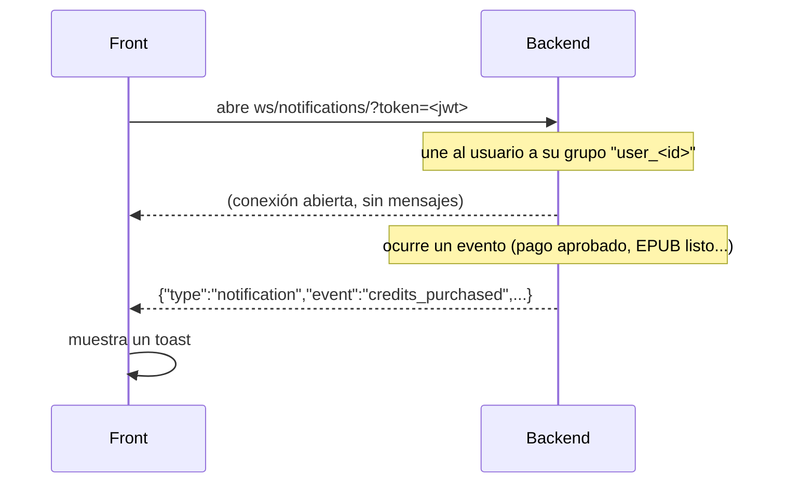

# Notificaciones en tiempo real (WebSocket)

### Pinta Ebook — Guía técnica (módulo `apps/notifications`)

El backend avisa al usuario **en vivo** de lo que pasa en su cuenta (créditos acreditados, EPUB listo, pago fallido) por un WebSocket. El front lo recibe y lo muestra como **toast**.

## Índice

1. [Cómo funciona](#1-cómo-funciona)
2. [Conectarse](#2-conectarse)
3. [Formato del mensaje](#3-formato-del-mensaje)
4. [Eventos disponibles](#4-eventos-disponibles)
5. [Guía para el front (Angular)](#5-guía-para-el-front-angular)
6. [Qué tener en cuenta](#6-qué-tener-en-cuenta)
7. [Para el backend: cómo emitir una notificación nueva](#7-para-el-backend-cómo-emitir-una-notificación-nueva)
8. [Cómo probar](#8-cómo-probar)

---

## 1. Cómo funciona



- **Un canal por usuario:** cada usuario recibe solo lo suyo.
- **Solo el servidor emite.** Lo que el cliente envíe por el socket se ignora.
- **Varias pestañas:** todas las pestañas abiertas del mismo usuario reciben la misma notificación.

---

## 2. Conectarse

| Entorno | URL |
|---|---|
| Local | `ws://localhost:8000/ws/notifications/?token=<access_token>` |
| Producción | `wss://pintaebook-backend.onrender.com/ws/notifications/?token=<access_token>` |

- El **JWT de acceso** va en el query param `?token=` (el WebSocket del navegador no permite el header `Authorization`). Es el mismo `access` que devuelve el login.
- Se conecta **una sola vez** al iniciar sesión y se cierra al cerrar sesión.
- **Sin token, o con token inválido o vencido, la conexión es rechazada.** En el navegador se ve como un `onclose` con código `1006` sin haberse abierto.

---

## 3. Formato del mensaje

Todos los mensajes son JSON con esta forma:

```json
{
  "type": "notification",
  "event": "credits_purchased",
  "level": "success",
  "title": "Créditos acreditados",
  "message": "Se acreditaron 500 créditos del paquete Estándar.",
  "data": {
    "credits_added": 500,
    "credits_available": 1500,
    "package": "Estándar",
    "transaction_id": 15
  },
  "timestamp": "2026-10-13T19:50:18.337631+00:00"
}
```

| Campo | Tipo | Descripción |
|---|---|---|
| `type` | string | Siempre `"notification"` |
| `event` | string | Identifica qué pasó (tabla de la sección 4). **Decidir la lógica por este campo** |
| `level` | string | `success`, `info`, `warning` o `error`. Define el color del toast |
| `title` | string | Título corto, listo para mostrar |
| `message` | string | Texto para el usuario, listo para mostrar |
| `data` | objeto | Datos propios de cada evento (puede venir vacío `{}`) |
| `timestamp` | string ISO 8601 | Momento del evento (UTC) |

---

## 4. Eventos disponibles

| `event` | Cuándo se envía | `level` | Campos en `data` |
|---|---|---|---|
| `credits_purchased` | Mercado Pago aprobó el pago y se acreditaron los créditos | `success` | `credits_added`, `credits_available`, `package`, `transaction_id` |
| `payment_failed` | El pago fue rechazado o cancelado | `error` | `package`, `transaction_id`, `status` (`fallido` o `cancelado`) |
| `epub_ready` | Se exportó un e-book a EPUB | `success` | `ebook_id`, `filename` |

**Qué hacer en el front con cada uno:**

- `credits_purchased`: mostrar el toast **y actualizar el saldo** con `data.credits_available`. Así no hace falta esperar al polling de `GET /api/billing/balance/`.
- `payment_failed`: mostrar el toast de error; se puede ofrecer volver a `/billing`.
- `epub_ready`: mostrar el toast. La descarga del archivo llega en la misma respuesta HTTP del export; la notificación es solo la confirmación.

> Se pueden agregar eventos nuevos sin cambiar el formato. El front debe **ignorar con gracia** un `event` que no conozca (mostrar `title` y `message` igual).

---

## 5. Guía para el front (Angular)

### Servicio

```ts
export interface AppNotification {
  type: 'notification';
  event: string;
  level: 'success' | 'info' | 'warning' | 'error';
  title: string;
  message: string;
  data: Record<string, unknown>;
  timestamp: string;
}

@Injectable({ providedIn: 'root' })
export class NotificationsService {
  readonly notifications$ = new Subject<AppNotification>();
  private ws: WebSocket | null = null;
  private retry = 0;
  private closedByUser = false;

  connect(): void {
    const token = localStorage.getItem('access_token');
    if (!token || this.ws) return;
    this.closedByUser = false;

    // environment.wsUrl: 'ws://localhost:8000' en local, 'wss://<backend>' en producción
    this.ws = new WebSocket(`${environment.wsUrl}/ws/notifications/?token=${token}`);

    this.ws.onopen = () => (this.retry = 0);
    this.ws.onmessage = (e) => this.notifications$.next(JSON.parse(e.data));
    this.ws.onclose = () => {
      this.ws = null;
      if (this.closedByUser) return;
      // Reconexión con espera creciente: 1 s, 2 s, 4 s... máximo 30 s
      const delay = Math.min(1000 * 2 ** this.retry++, 30000);
      setTimeout(() => this.connect(), delay);
    };
  }

  disconnect(): void {
    this.closedByUser = true;
    this.ws?.close();
    this.ws = null;
  }
}
```

### Uso

1. Llamar `connect()` **después de iniciar sesión** (y al arrancar la app si ya hay sesión).
2. Llamar `disconnect()` en el **logout**.
3. Suscribirse a `notifications$` en un componente raíz y mostrar el toast según `level`:

```ts
this.notifications.notifications$.subscribe((n) => {
  this.toast.show(n.title, n.message, n.level);

  if (n.event === 'credits_purchased') {
    this.balance.set(n.data['credits_available'] as number);
  }
});
```

---

## 6. Qué tener en cuenta

| Tema | Detalle |
|---|---|
| **No se guardan** | Si el usuario no tiene el socket abierto en ese momento, la notificación **se pierde**. Es un aviso en vivo, no un historial. Para saber el saldo real, `GET /api/billing/balance/` sigue siendo la fuente de verdad |
| **Token vencido** | El token se valida **solo al conectar**. Una conexión ya abierta sigue viva aunque el token venza. Al **reconectar**, usar siempre el `access` actual (renovarlo con `/api/auth/refresh/` si venció) |
| **Reconexión** | El servidor en el plan gratuito de Render puede "dormirse" o reiniciarse y cortar el socket. Por eso conviene la reconexión automática del ejemplo |
| **Rechazo** | Una conexión rechazada llega como cierre `1006`. Si pasa en bucle, probablemente el token es inválido: renovarlo antes de reintentar |
| **Varias pestañas** | Cada pestaña abre su propio socket y todas reciben el aviso. Si no se quiere duplicar el toast, mostrarlo solo en la pestaña visible (`document.visibilityState`) |
| **Con el backend caído** | El resto de la app no depende del socket: si no conecta, los pagos y exportaciones funcionan igual |

---

## 7. Para el backend: cómo emitir una notificación nueva

Desde cualquier parte del backend:

```python
from apps.notifications.services import notify_user

notify_user(
    user.id,
    'ebook_completed',          # event
    'E-book listo',             # title
    'Tu e-book terminó de generarse.',  # message
    level='success',            # success | info | warning | error
    data={'ebook_id': str(ebook.id)},
)
```

- Si se llama dentro de una transacción de base de datos, **se envía recién al confirmarla** (no avisa de algo que luego se revierte).
- **Nunca levanta excepciones**: si falla Redis, solo queda un warning en los logs y el flujo original sigue.
- Hoy se emite desde `apps/billing/services.py` (pago aprobado / fallido) y `apps/exporter/views.py` (EPUB).

---

## 8. Cómo probar

**Automático:**

```bash
docker compose exec web python manage.py test apps.notifications
```

**Manual (consola del navegador, con sesión iniciada):**

```js
const ws = new WebSocket('ws://localhost:8000/ws/notifications/?token=' + localStorage.getItem('access_token'));
ws.onmessage = (e) => console.log(JSON.parse(e.data));
```

Con el socket abierto, disparar una notificación desde el backend:

```bash
docker compose exec web python manage.py shell -c "
from apps.notifications.services import notify_user
notify_user('<ID_DEL_USUARIO>', 'info', 'Prueba', 'Hola desde el backend', level='info')"
```

El mensaje aparece en la consola del navegador. El `<ID_DEL_USUARIO>` es el `id` que devuelve `GET /api/auth/me/`.

**Prueba real de punta a punta:** con el socket abierto, comprar un paquete (sección de billing) o exportar un e-book a EPUB; debe llegar `credits_purchased` o `epub_ready`.
