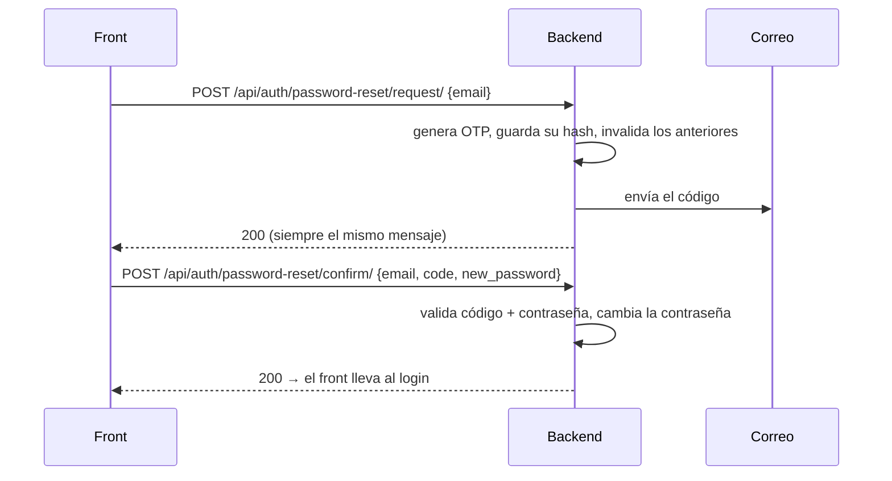

# Recuperar contraseña con OTP por correo

### Pinta Ebook — Documentación técnica (módulo `accounts`)

> **Estado:** implementado y probado en local (31 tests de `apps.accounts`). El envío real de correo en producción depende del proveedor elegido (sección 5).

## 1. Qué hace

El usuario que olvidó su contraseña pide un **código de 6 dígitos (OTP)**, le llega por correo a la dirección de su cuenta y con ese código fija una contraseña nueva. Funciona con cualquier correo registrado (no solo Gmail).



## 2. Endpoints

Ambos son **públicos** (sin JWT).

### 2.1 `POST /api/auth/password-reset/request/`

```json
{ "email": "usuario@gmail.com" }
```

- **`200`** siempre, con `{"detail": "Si el correo está registrado, te enviamos un código de verificación."}`. **No revela** si la cuenta existe (evita enumerar usuarios): el front debe mostrar el mismo mensaje en todos los casos.
- `400` solo si el `email` no tiene formato de correo.
- Si pidió otro código hace menos de **60 s**, responde `200` pero no reenvía (el front puede deshabilitar "Reenviar" 60 s).

### 2.2 `POST /api/auth/password-reset/confirm/`

```json
{ "email": "usuario@gmail.com", "code": "381174", "new_password": "Otra-Clave-Nueva-456" }
```

| Campo | Regla |
|---|---|
| `email` | El mismo del paso 1 (no distingue mayúsculas) |
| `code` | Exactamente 6 dígitos (string; puede empezar con 0) |
| `new_password` | Mínimo 8 y validadores de Django (no común, no solo números, no parecida al usuario) |

| Código | Cuándo | Cuerpo |
|---|---|---|
| `200` | Contraseña cambiada | `{"detail": "Contraseña actualizada. Ya podés iniciar sesión."}` |
| `400` | Código incorrecto, vencido, ya usado, bloqueado o correo desconocido (**mismo mensaje para todos**) | `{"code": ["El código es inválido o ha vencido."]}` |
| `400` | Formato de código inválido | `{"code": ["El código debe tener 6 dígitos."]}` |
| `400` | Contraseña débil (el código **no se consume**: puede reintentar) | `{"new_password": ["..."]}` |

No inicia sesión: tras el `200` el front lleva al login.

## 3. Reglas de seguridad

| Regla | Valor |
|---|---|
| Longitud | 6 dígitos, generados con `secrets` |
| Vigencia | 10 minutos |
| Uso | Una sola vez |
| Intentos | Máximo 5 fallidos por código; luego se bloquea (hay que pedir uno nuevo) |
| Código vigente | Uno por usuario: pedir otro invalida el anterior |
| Reenvío | Espera de 60 s entre pedidos |
| Almacenamiento | Solo el HMAC-SHA256 (atado al usuario y a `SECRET_KEY`); nunca el código en claro |
| Comparación | Tiempo constante (`hmac.compare_digest`) |
| Respuestas | Genéricas: no se puede saber si un correo está registrado |

Tabla: `password_reset_otps` (migración `accounts/0003_passwordresetotp`).

**Límites conocidos:** no hay limitación por IP (solo por cuenta); los tokens JWT ya emitidos siguen válidos hasta vencer después de cambiar la contraseña (no se usa blacklist); una cuenta creada solo con Google (sin contraseña) puede fijar una con este flujo.

## 4. Configuración (variables de entorno)

| Variable | Default | Para qué |
|---|---|---|
| `EMAIL_BACKEND` | `console` | `django.core.mail.backends.console.EmailBackend` imprime el correo en los logs; `...smtp.EmailBackend` envía por SMTP |
| `EMAIL_HOST` | `smtp.gmail.com` | Servidor SMTP |
| `EMAIL_PORT` | `587` | Puerto |
| `EMAIL_USE_TLS` | `True` | STARTTLS |
| `EMAIL_HOST_USER` | — | Cuenta remitente |
| `EMAIL_HOST_PASSWORD` | — | Contraseña de **aplicación** |
| `DEFAULT_FROM_EMAIL` | `EMAIL_HOST_USER` | Remitente que ve el usuario |

Timeout de envío fijo en 10 s. Si el envío falla, se registra el error en logs y el endpoint igual responde `200`.

## 5. Probar

**Sin enviar nada (por defecto):** con el backend levantado, pedir el código y leerlo de los logs.

```bash
curl -X POST http://localhost:8000/api/auth/password-reset/request/ -H "Content-Type: application/json" -d '{"email":"usuario@correo.com"}'
docker compose logs web --since 1m | grep "código de verificación"
```

**Con correo real desde local (Gmail):**
1. En la cuenta Gmail remitente, activar la **verificación en 2 pasos** y crear una **contraseña de aplicación** (myaccount.google.com → Seguridad → Contraseñas de aplicaciones).
2. En `.env`: `EMAIL_BACKEND=django.core.mail.backends.smtp.EmailBackend`, `EMAIL_HOST_USER`, `EMAIL_HOST_PASSWORD` (la de aplicación), `DEFAULT_FROM_EMAIL`.
3. `docker compose restart web` y repetir el `curl`: el correo llega a la bandeja (revisar spam).

**Tests:** `docker compose exec web python manage.py test apps.accounts`.

## 6. Producción (Render) con Brevo

**Render (plan free) bloquea el SMTP saliente** (puertos 25, 465 y 587; vigente desde 26/09/2025), por eso Gmail por SMTP no funciona ahí. Se usa **Brevo por API HTTP** con `django-anymail` (dependencia en `requirements.txt`). El código del OTP no cambia: solo cambia `EMAIL_BACKEND`.

### Preparar Brevo (una vez)

1. Cuenta **Free** en brevo.com.
2. **Settings → Senders, Domains & Dedicated IPs → Senders → Add a sender**: crear y **verificar** (código de 6 dígitos por correo) el remitente.
3. **SMTP & API → API Keys → Generate a new API key** (clave **v3**, no la "SMTP key"). Se muestra una sola vez.

### Variables (Render y/o `.env` local)

| Variable | Valor |
|---|---|
| `EMAIL_BACKEND` | `anymail.backends.brevo.EmailBackend` |
| `BREVO_API_KEY` | La API key v3 (secreta; nunca al repositorio) |
| `DEFAULT_FROM_EMAIL` | El remitente **verificado** en Brevo. Admite nombre: `Pinta Ebook <cuenta@gmail.com>` |

### Despliegue

- **`migrate` es obligatorio:** la tabla `password_reset_otps` la crea la migración `accounts/0003`. Sin ella, `/password-reset/request/` da `500`. En Render, en el **Build Command**: `pip install -r requirements.txt && python manage.py migrate --noinput`.
- Con Auto-Deploy en "On Commit", el merge a `main` instala la dependencia, migra y levanta el código.
- Si **no** se define `EMAIL_BACKEND`, el correo sale por consola: el código aparece en los **Logs** de Render (el endpoint no se rompe).
- Si se define el backend de Brevo pero la API key o el remitente son inválidos, el envío falla, queda el error en los logs y el endpoint igual responde `200` (ver "Errores frecuentes").

### Errores frecuentes

| Síntoma | Causa probable |
|---|---|
| El endpoint responde `200` pero no llega correo | Falló el envío: revisar logs (`No se pudo enviar el OTP...`). Es intencional que el usuario no vea el error |
| `401`/`Invalid API key` en logs | `BREVO_API_KEY` incorrecta, o es la SMTP key en vez de la API key v3 |
| `sender ... not valid` en logs | `DEFAULT_FROM_EMAIL` no coincide con un remitente verificado en Brevo |
| Llega a spam | Remitente Gmail sin dominio autenticado: es esperable con Gmail |

## 7. Archivos

| Archivo | Qué hace |
|---|---|
| `apps/accounts/models.py` | `PasswordResetOTP` |
| `apps/accounts/services.py` | `request_password_reset`, `confirm_password_reset` |
| `apps/accounts/serializers.py` | `PasswordResetRequestSerializer`, `PasswordResetConfirmSerializer` |
| `apps/accounts/views.py` | `PasswordResetRequestView`, `PasswordResetConfirmView` |
| `apps/accounts/test_password_reset.py` | 16 tests |
| `config/settings/base.py` | Configuración de correo |
