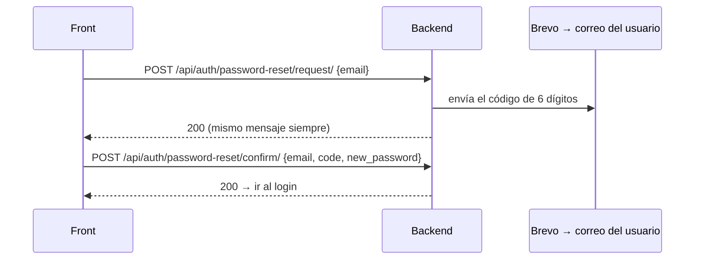

# Recuperar contraseña con OTP por correo

### Pinta Ebook — Guía técnica (módulo `accounts`)

El usuario que olvidó su contraseña pide un **código de 6 dígitos (OTP)**, le llega al correo de su cuenta y con ese código define una contraseña nueva.

El correo se envía con **Brevo** (API HTTP) mediante la librería `django-anymail`.

## Índice

1. [Cómo funciona](#1-cómo-funciona)
2. [Endpoints](#2-endpoints)
3. [Guía para el front](#3-guía-para-el-front)
4. [Reglas del código](#4-reglas-del-código)
5. [Tecnología y configuración](#5-tecnología-y-configuración)
6. [Cómo probar](#6-cómo-probar)

---

## 1. Cómo funciona



Los dos endpoints son **públicos**: no llevan token JWT.

---

## 2. Endpoints

| Método | Ruta | Para qué |
|---|---|---|
| `POST` | `/api/auth/password-reset/request/` | Envía el código al correo |
| `POST` | `/api/auth/password-reset/confirm/` | Valida el código y cambia la contraseña |

### 2.1 `POST /api/auth/password-reset/request/`

**Body**

```json
{ "email": "usuario@gmail.com" }
```

**Respuesta `200 OK`** (siempre la misma, exista o no la cuenta)

```json
{ "detail": "Si el correo está registrado, te enviamos un código de verificación." }
```

| Código | Cuándo | Qué hacer en el front |
|---|---|---|
| `200` | Siempre que el formato sea válido | Pasar a la pantalla del código y mostrar el mensaje |
| `400` | `email` con formato inválido | Mostrar el error en el campo |

> **Importante:** el `200` **no confirma** que el correo exista ni que el envío haya salido. Es a propósito, para no revelar qué correos están registrados. Mostrar siempre el mismo mensaje.

### 2.2 `POST /api/auth/password-reset/confirm/`

**Body**

```json
{
  "email": "usuario@gmail.com",
  "code": "381174",
  "new_password": "Otra-Clave-Nueva-456"
}
```

| Campo | Tipo | Regla |
|---|---|---|
| `email` | string | El mismo del paso 1 |
| `code` | string | Exactamente 6 dígitos. **Enviarlo como texto** (puede empezar con `0`) |
| `new_password` | string | Mínimo 8 caracteres, no común, no solo números, no parecida a los datos del usuario |

**Respuesta `200 OK`**

```json
{ "detail": "Contraseña actualizada. Ya podés iniciar sesión." }
```

> No inicia sesión: después del `200` hay que llevar al usuario al **login**.

**Errores**

| Código | Cuándo | Cuerpo de ejemplo | Qué hacer en el front |
|---|---|---|---|
| `400` | Código incorrecto, vencido, ya usado o bloqueado | `{"code": ["El código es inválido o ha vencido."]}` | Mostrar el mensaje; ofrecer "Reenviar código" |
| `400` | `code` no tiene 6 dígitos | `{"code": ["El código debe tener 6 dígitos."]}` | Mostrar el error en el campo |
| `400` | Contraseña débil | `{"new_password": ["This password is too common."]}` | Mostrar el error. **El código sigue siendo válido**, puede reintentar |
| `400` | `email` inválido | `{"email": ["Enter a valid email address."]}` | Mostrar el error en el campo |

El mensaje de "código inválido" es el mismo para todos los casos (incorrecto, vencido, correo desconocido). No se puede distinguir.

---

## 3. Guía para el front

### Pantallas

1. **Pedir código:** campo de correo y botón "Enviar código". Al recibir `200`, pasar a la pantalla 2.
2. **Ingresar código:** campos de código, contraseña nueva y confirmación, más un botón "Reenviar código".
3. **Éxito:** llevar al login.

### Servicio (Angular)

```ts
export interface PasswordResetConfirmPayload {
  email: string;
  code: string;          // 6 dígitos, como string
  new_password: string;
}

requestPasswordReset(email: string) {
  return this.http.post<{ detail: string }>(`${this.BASE}/auth/password-reset/request/`, { email });
}

confirmPasswordReset(payload: PasswordResetConfirmPayload) {
  return this.http.post<{ detail: string }>(`${this.BASE}/auth/password-reset/confirm/`, payload);
}
```

### Qué tener en cuenta

- **Reenviar código:** deshabilitar el botón durante **60 segundos**. Si se pide antes, el backend responde `200` pero no envía nada.
- **Contraseña:** validar en el front que "nueva" y "confirmar" coincidan antes de enviar (el backend solo recibe `new_password`).
- **Mensaje al usuario:** indicar que revise también la carpeta de **spam**.
- **Errores:** leer los campos `code`, `new_password` o `email` del cuerpo del `400`.

> Hay una implementación de referencia en `pintaebook-front-tester`: `src/app/features/auth/forgot-password.component.ts` (ruta `/auth/forgot-password`).

---

## 4. Reglas del código

| Regla | Valor |
|---|---|
| Longitud | 6 dígitos |
| Vigencia | 10 minutos |
| Uso | Una sola vez |
| Intentos fallidos | Máximo 5; después hay que pedir un código nuevo |
| Reenvío | Espera de 60 segundos entre pedidos |
| Código vigente | Uno solo: pedir otro invalida el anterior |

---

## 5. Tecnología y configuración

| Pieza | Detalle |
|---|---|
| Envío de correo | **Brevo** (API HTTP) |
| Librería | `django-anymail==15.2` (ya está en `requirements.txt`) |
| Base de datos | Tabla `password_reset_otps`, creada por la migración `accounts/0003_passwordresetotp` |

### Variables de entorno

| Variable | Valor |
|---|---|
| `EMAIL_BACKEND` | `anymail.backends.brevo.EmailBackend` |
| `BREVO_API_KEY` | API key **v3** de Brevo (secreta; no es la "SMTP key") |
| `DEFAULT_FROM_EMAIL` | Remitente **verificado** en Brevo. Ej: `Pinta Ebook <cuenta@gmail.com>` |

### Despliegue

- **Ejecutar `python manage.py migrate`:** es obligatorio, porque crea la tabla de los códigos. Sin esa migración, `/password-reset/request/` responde `500`.
- Cargar las 3 variables en el servidor (en Render, en el panel de variables de entorno).

---

## 6. Cómo probar

```bash
# 1) Pedir el código (llega al correo)
curl -X POST http://localhost:8000/api/auth/password-reset/request/ \
     -H "Content-Type: application/json" -d '{"email":"usuario@gmail.com"}'

# 2) Cambiar la contraseña con el código recibido
curl -X POST http://localhost:8000/api/auth/password-reset/confirm/ \
     -H "Content-Type: application/json" \
     -d '{"email":"usuario@gmail.com","code":"381174","new_password":"Otra-Clave-Nueva-456"}'
```

**Si no llega el correo:** revisar spam y los logs (`docker compose logs web --since 2m`). El backend responde `200` aunque el envío falle; el motivo queda en el log (`No se pudo enviar el OTP...`).

| Causa frecuente | Cómo se ve en el log |
|---|---|
| API key incorrecta o es la SMTP key | Error de autenticación de Brevo |
| `DEFAULT_FROM_EMAIL` no coincide con un remitente verificado | Mensaje de remitente no válido |
| `EMAIL_BACKEND` mal escrito | `ModuleNotFoundError` |

**Tests automáticos:**

```bash
docker compose exec web python manage.py test apps.accounts
```
